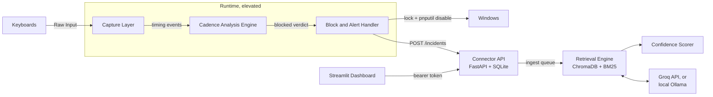

# Continuum

**A closed-loop defence against keystroke-injection attacks on Windows: detect the attack,
contain the device, record the incident, and answer questions about it.**


Devices such as the USB Rubber Ducky, Digispark and Bash Bunny pretend to be a keyboard and
type a pre-recorded attack faster than any person. Windows trusts them like any other
keyboard. Continuum watches the typing rhythm of every physical keyboard, and when one stops
looking human it:

1. **locks the workstation and disables that one device** (HID Firewall),
2. **records a structured, validated incident** (Connector API), and
3. **lets an analyst ask what happened and what to do next**, answered only from the
   incident history and response playbooks, with citations, or an explicit "not enough
   evidence" when the records do not support an answer (IncidentRAG).

Detection, response, incident storage, search and the dashboard all run on the local machine,
with no telemetry. By default IncidentRAG's answers are written by Qwen3 27B on Groq's
cloud API, which receives the question and the retrieved incident and playbook text; set
`rag.llm_provider: ollama` to run the same model locally and keep everything offline.
Continuum never records which keys were pressed, only their timing.

Built as a college software engineering project.

## How it works



- **Capture Layer:** Windows Raw Input, which, unlike a keyboard hook, reports *which*
  physical device sent each keystroke. Only timestamps, up/down and a device id leave this
  layer.
- **Cadence Analysis Engine:** 17 timing features over sliding 30-keystroke windows,
  scored by an Isolation Forest trained on your own typing, with a two-window debounce.
- **Block and Alert Handler:** lock the workstation, try to disable the device with
  `pnputil` and verify the result, show a notification, and send the incident. Windows
  refuses to disable a keyboard while it is in use, so for keyboard injectors the lock is
  what contains the attack (see [Known limitations](#known-limitations)). Safety rails apply
  throughout (see [Security design](#security-design)).
- **Connector API:** a local FastAPI service, with bearer-token authentication even on
  localhost, that validates and stores every incident.
- **Retrieval Engine and Confidence Scorer:** hybrid retrieval over incidents and playbooks,
  a cited answer from an LLM (Qwen3 on Groq by default, or Llama 3.1 8B in local Ollama), and a confidence gate that refuses when the evidence is
  weak.
- **Dashboard:** live device status, incidents, Ask IncidentRAG, calibration and settings.

More detail: [docs/ARCHITECTURE.md](docs/ARCHITECTURE.md).

## Results at a glance

From [docs/EVALUATION.md](docs/EVALUATION.md), regenerated by `.\tasks.ps1 evaluate`. The
detector figures there come from simulated typing until you record your own baseline.

| | Result |
| --- | --- |
| Burst and slowed injection, window-level recall | 1.00 |
| Randomized (human-paced) injection, window-level recall | 0.04, effectively missed |
| First injected keystroke to device blocked | about 270 ms, at the 40th keystroke |
| Incident retrievable by IncidentRAG | about 3 s after the first keystroke |
| IncidentRAG retrieval hit rate at 5 (30 questions) | 0.97 |
| Off-topic questions refused | 10 of 10 |

## Requirements

- Windows 10 or 11, 64-bit, with an account that can approve an administrator (UAC)
  prompt.
- About 2 GB of free disk space for the Python packages and embedding model (another 5 GB
  for the optional local Ollama model).
- A free Groq API key and an internet connection for IncidentRAG's answers, or 8 GB of RAM
  for the local Ollama model instead.
- For the hardware demo: a Digispark ATtiny85 board and a second keyboard. A laptop's
  built-in keyboard counts.

## Installation

### 1. Install the tools

| Tool | Get it | Notes |
| --- | --- | --- |
| Python 3.12 (64-bit) | [python.org/downloads/windows](https://www.python.org/downloads/windows/) | Tick **Add python.exe to PATH**. Check with `py -3.12 --version`. |
| Git | [git-scm.com/download/win](https://git-scm.com/download/win) | Default options are fine. |
| Groq API key | [console.groq.com/keys](https://console.groq.com/keys) | Free. Used by default for IncidentRAG's answers. |
| Ollama (optional) | [ollama.com/download](https://ollama.com/download) | Only for fully offline answers; runs in the system tray. |
| Arduino IDE 2.x | [arduino.cc/en/software](https://www.arduino.cc/en/software) | Only needed to flash the Digispark. |

Only if you want fully offline answers instead of Groq: download the local model (about
4.9 GB) and set `rag.llm_provider: ollama` in `config/local.yaml`.

```powershell
ollama pull llama3.1:8b
```

### 2. Get the code and set it up

In PowerShell:

```powershell
git clone https://github.com/PR0XCITY/Continuum.git
cd Continuum
Set-ExecutionPolicy -Scope CurrentUser RemoteSigned   # once per user, if scripts are blocked
.\tasks.ps1 setup
```

`setup` does the following:

- creates `.venv` with Python 3.12 and installs the pinned dependencies,
- creates `.env` with a new random API token (an existing `.env` is never touched),
- downloads the embedding model once, so everything after this runs offline,
- checks that the configured LLM is ready: a Groq key in `.env`, or the Ollama model.

Then open `.env` and paste your Groq key after `GROQ_API_KEY=`. `.env` is gitignored and the
key is never logged.

Clone into a short folder path such as `C:\src\Continuum`. PyTorch, which
sentence-transformers needs, installs files nested deeply enough to pass Windows' 260
character path limit when the project folder is already deep. If setup fails with
`No such file or directory` under `torch\include`, move the clone somewhere shorter, or enable
Windows long path support as pip's error message describes.

If Python 3.12 is installed somewhere `py` does not find (a conda environment, for example),
set `$env:CONTINUUM_PYTHON` to that `python.exe` before running setup.

[`just`](https://github.com/casey/just) users can type `just setup`, `just run-all` and so
on instead: every `just` recipe calls the matching `tasks.ps1` target.

### 3. Teach it your typing

Continuum learns what normal typing looks like on your keyboard, from the dashboard:

1. Start everything with `.\tasks.ps1 run-all` (see [Running](#running)). Without a trained
   model the runtime starts in recording-only mode: it captures timing, but protects nothing
   yet.
2. Open the dashboard's **Train** page at http://127.0.0.1:8501. Click **Start recording**,
   type the paragraph shown at your usual pace, then click **Stop and save**. The page shows
   your words per minute and accuracy as you type.
3. Repeat with the next paragraph until the baseline reaches about 150 windows (around five
   paragraphs; type one of them faster than usual). Training is possible from 60.
4. Click **Train model**. The runtime picks the new model up within a few seconds, with no
   restart, and protection starts.

The typing is recorded by the runtime through the same Raw Input capture detection uses, so
the model learns from exactly the signal it is later judged on, and from the physical
keyboard you used. Only timing statistics are saved, to `data\baselines\<you>.npz`; what you
type in the page never leaves your browser. Detection is paused while a session records.

`.\tasks.ps1 record-baseline` and `.\tasks.ps1 train-model` do the same from a terminal.

### 4. Check everything works

```powershell
.\tasks.ps1 test    # about 470 tests; every Windows call is mocked
.\tasks.ps1 lint
```

## Running

```powershell
.\tasks.ps1 run-all     # API, dashboard and the elevated runtime, each in its own window
.\tasks.ps1 status      # which components are running
.\tasks.ps1 stop-all    # stops everything cleanly; disabled devices are released first
```

`run-all` opens three titled windows, Continuum api, Continuum dashboard and Continuum
runtime. The runtime window needs your approval at the Windows administrator prompt, because
disabling a device requires it. Each window's output is also saved to
`data\logs\<component>.log`.

| Component | Address | Run it on its own |
| --- | --- | --- |
| Dashboard | http://127.0.0.1:8501 | `.\tasks.ps1 run-dashboard` |
| Connector API, with interactive docs | http://127.0.0.1:8731/docs | `.\tasks.ps1 run-api` |
| HID Firewall runtime | (no UI; its window shows its log) | `.\tasks.ps1 run-runtime` from an Administrator PowerShell |

Other commands:

| Command | What it does |
| --- | --- |
| `.\tasks.ps1 release-all` | The kill switch: re-enables every device Continuum disabled. Run it from an Administrator PowerShell. |
| `.\tasks.ps1 evaluate` | Reruns every measurement and regenerates `docs/EVALUATION.md`. |

To start Continuum automatically at logon, see [docs/AUTOSTART.md](docs/AUTOSTART.md). It is
not enabled by default.

## Flashing the Digispark test payloads

The four sketches in [`tools/attacks/`](tools/attacks/) only ever type the harmless phrase
"continuum test payload". They never open a shell, never press Win, Ctrl or Alt, and type
once, then stop.

1. In Arduino IDE, add the Digistump board index under **File > Preferences > Additional
   boards manager URLs**, then install **Digistump AVR Boards**.
2. Run `Install Digistump Drivers.bat` as Administrator. It comes with that package; the
   exact path is in the attacks README.
3. Open a sketch, for example `tools/attacks/burst/burst.ino`, select **Digispark (Default -
   16.5mhz)**, click **Upload**, and plug the board in when prompted.

[tools/attacks/README.md](tools/attacks/README.md) has the board index address, driver
troubleshooting and the safe test procedure.

## Demo

[docs/DEMO.md](docs/DEMO.md) is a five-minute script with exact commands and expected
results. It covers:

1. normal typing being left alone,
2. a burst attack locking the screen and disabling the device,
3. the incident in the dashboard,
4. IncidentRAG answering with citations,
5. IncidentRAG refusing an off-topic question,
6. the evasion case it misses,
7. releasing everything.

## Configuration

Defaults live in [`config/default.yaml`](config/default.yaml). Override them per machine in
`config/local.yaml` (gitignored; the dashboard's Settings page writes it), or with
environment variables shaped `CONTINUUM_<SECTION>__<FIELD>` (for example
`CONTINUUM_RESPONSE__MODE=alert_only`). The precedence, from highest, is environment, then
`local.yaml`, then `default.yaml`. The runtime reads its settings at startup, so restart it
after a change.

| Key | Default | Meaning |
| --- | --- | --- |
| `detection.sensitivity` | `5` | 1 (fewest alerts) to 10 (most). 5 uses the model's calibrated threshold unchanged; each step moves it by 0.01. |
| `response.mode` | `lock_and_disable` | `alert_only`, `lock_only`, `disable_only` (disable the device and leave the PC unlocked, locking only if the disable fails) or `lock_and_disable`. Without elevation the runtime falls back to `lock_only`. |
| `response.dry_run` | `false` | Log every decision but never lock or disable anything. |
| `response.allowlist` | `[]` | Device instance ids that are never disabled, such as a barcode scanner. |
| `response.auto_release_timeout_seconds` | `600` | Every disabled device is re-enabled after this long. |
| `response.allow_non_usb_disable` | `false` | Allow disabling non-USB (for example built-in PS/2) keyboards. |
| `connector.host`, `connector.port` | `127.0.0.1`, `8731` | Where the API listens. |
| `connector.database_path` | `data/db/continuum.sqlite3` | The incident database. |
| `connector.auth_token_env_var` | `CONTINUUM_API_TOKEN` | Which environment variable (or `.env` entry) holds the bearer token. |
| `rag.llm_provider` | `groq` | Which LLM writes answers: `groq` (cloud API) or `ollama` (local, offline). |
| `rag.groq_model`, `rag.groq_base_url` | `qwen/qwen3.8-27b`, `https://api.groq.com/openai/v1` | The Groq model and endpoint. Groq retires models over time; pick one your key lists at `/models`. |
| `rag.groq_api_key_env_var` | `GROQ_API_KEY` | Which `.env` entry holds the Groq key. |
| `rag.ollama_host`, `rag.ollama_model` | `http://127.0.0.1:11434`, `llama3.1:8b` | The local LLM, when `llm_provider` is `ollama`. |
| `rag.llm_temperature`, `rag.llm_timeout_seconds` | `0.1`, `30` | Generation settings, either provider. |
| `rag.embedding_model` | `all-MiniLM-L6-v2` | The sentence-transformers model for retrieval. |
| `rag.chroma_path`, `rag.chroma_collection` | `data/chroma`, `continuum_incidents` | The vector store. |
| `rag.corpus_path` | `data/corpus` | The playbooks IncidentRAG may cite. |
| `rag.top_k` | `5` | Chunks given to the model as context. |
| `rag.min_similarity` | `0.45` | The similarity floor used by the confidence gate. |
| `rag.confidence_threshold` | `0.5` | Below this, IncidentRAG refuses to answer. |
| `rag.chunk_size_tokens`, `rag.chunk_overlap_tokens` | `300`, `50` | Chunking, in words. |
| `dashboard.host`, `dashboard.port` | `127.0.0.1`, `8501` | Where the dashboard listens. |
| `logging.level`, `logging.directory` | `INFO`, `data/logs` | Runtime logging. |

`detection.window_size`, `detection.debounce_ms`, `detection.anomaly_threshold` and
`detection.debounce_windows` are present in the schema but not read by the current
detector. It uses 30-keystroke windows, a two-window debounce and the trained model's own
calibrated threshold; use `sensitivity` to tune it.

## Security design

- **Never a keylogger.** No code path records which key was pressed. Only timestamps,
  up/down, a press counter and a device id leave the capture layer. Baselines store window
  statistics, never text.
- **Raw Input, not hooks.** Only Raw Input identifies the physical device, so Continuum can
  disable the attacking device and leave yours working.
- **Least privilege.** Only the runtime is elevated, because disabling devices needs it. The
  API and dashboard run as a normal user, and the elevated process never runs a web server.
- **Safety rails that no setting can turn off.** Continuum never disables:
  - the last enabled keyboard,
  - an allowlisted device,
  - a non-USB keyboard (unless configured).

  Every disabled device is re-enabled after a timeout, `--release-all` releases everything
  at once, and the runtime releases everything when it starts and stops. Rules are checked
  in pure code before `pnputil` runs, and results are verified rather than assumed.
- **Lock before anything else.** Anything an attack types after the lock goes to the lock
  screen.
- **Authentication everywhere.**
  - Every API route except `/health` needs the bearer token, even from localhost.
  - The token is compared in constant time.
  - The API refuses every request if no token is set.
  - Request bodies are size-limited and requests rate-limited.
- **Validated data only.** Incidents are schema-validated with unknown fields rejected,
  notes are sanitised, and only a fixed-template document of validated fields ever enters
  the RAG corpus. Prompt-injection phrasing in notes is flagged and always passed to the
  model as quoted data, never as instructions.
- **Honest answers.** IncidentRAG cites numbered sources, checks every citation, and refuses
  ("insufficient evidence") rather than guessing.
- **Local by default, with one disclosed exception.** The API and dashboard bind to
  `127.0.0.1`, and ChromaDB and Streamlit telemetry are switched off. With the default
  `llm_provider: groq`, IncidentRAG sends the question and the top 5 retrieved chunks
  (incident records and playbooks) to Groq over HTTPS to write the answer; the dashboard says
  so on the Ask page and labels every answer with the model that wrote it. Choose `ollama` to
  keep that local too. Untrusted text is HTML-escaped in the dashboard,
  so it cannot load remote content.

## Known limitations

Measured in [docs/EVALUATION.md](docs/EVALUATION.md):

- **Human-paced attacks get through.** An injection that randomises its timing to look
  human is detected in only about 4 percent of windows. Catching it would need signals
  beyond typing rhythm.
- **Some keystrokes always land.** Raw Input can observe keystrokes but not hold them back,
  and blocking needs two 30-keystroke windows, so an attack's first 40 keystrokes always
  reach the focused window. A payload shorter than 40 keystrokes is never detected.
- **A small baseline means false positives.** Typing much faster than anything in your
  baseline can be blocked. Include a fast session when recording.
- **Windows will not disable a keyboard in use.** `pnputil` refuses with "Cannot disable
  critical system device", and forcing it only takes effect after a reboot. So against a
  keyboard injector Continuum contains the attack by locking the workstation, and the rest
  of the payload types into the lock screen's password box (harmlessly, unless the payload
  presses Enter). Unplugging the device is what makes containment permanent. In
  `disable_only` mode the lock is the fallback for exactly this case.
- **The Digispark's bootloader delay is excluded.** It waits about 5 seconds after plug-in
  before typing, so plug-in to lock takes longer than the measured first-keystroke-to-lock
  time.
- **IncidentRAG can be over-cautious.** It sometimes refuses questions the corpus does
  answer; the confidence threshold may need tuning for your data.

## Project layout

```
config/            default configuration (local.yaml overrides are gitignored)
data/corpus/       response playbooks IncidentRAG may cite
data/eval/         IncidentRAG evaluation questions
docs/              architecture, demo script, evaluation report, autostart guide
src/continuum/
  capture/         Raw Input capture (Capture Layer)
  detection/       features, baseline, model, scorer (Cadence Analysis Engine)
  response/        lock, device disable/enable, alerts (Block and Alert Handler)
  runtime.py       the elevated main loop tying the three together
  connector/       FastAPI service and SQLite (Connector API)
  rag/             ingest, retrieval, answers, confidence gate (IncidentRAG)
  dashboard/       Streamlit dashboard
tools/             baseline recording, training, evaluation, simulators, Digispark sketches
tests/             pytest suite, including an end-to-end integration test
tasks.ps1          every command (justfile mirrors it)
```

## Documentation

- [docs/ARCHITECTURE.md](docs/ARCHITECTURE.md): module responsibilities and data flow.
- [docs/DEMO.md](docs/DEMO.md): the five-minute demo script.
- [docs/EVALUATION.md](docs/EVALUATION.md): every measured result, with limitations.
- [docs/AUTOSTART.md](docs/AUTOSTART.md): optional start at logon with Task Scheduler.
- [tools/attacks/README.md](tools/attacks/README.md): flashing and safely running the test
  payloads.
- [docs/windows_notes.md](docs/windows_notes.md): Windows-specific capture behaviour.

## License

No license has been chosen yet; all rights are reserved by the author.
