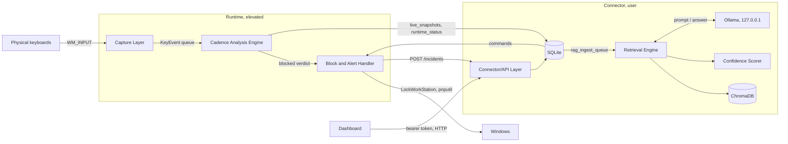

# Continuum architecture

This document describes what each part of Continuum is responsible for and
how data moves between them. Its sections follow the System Design chapter
of the project report: Capture Layer, Cadence Analysis Engine, Block and
Alert Handler, Connector/API Layer, Retrieval Engine, Confidence Scorer and
Dashboard.

## Processes and trust boundaries

Continuum runs as three local processes plus a local LLM server. Nothing
leaves the machine.

| Process | Privilege | Contains |
| --- | --- | --- |
| Runtime (`python -m continuum.runtime`) | Administrator | Capture Layer, Cadence Analysis Engine, Block and Alert Handler |
| Connector (`uvicorn continuum.connector.app:app`) | standard user | Connector/API Layer, Retrieval Engine, Confidence Scorer |
| Dashboard (`streamlit run src/continuum/dashboard/app.py`) | standard user | Dashboard |
| Ollama (`127.0.0.1:11434`) | standard user | the local LLM used by the Retrieval Engine |

Only the runtime is elevated, because only disabling a device needs it.
Keeping the web stack out of the elevated process means a bug in an HTTP
handler can never run with Administrator rights.

## Capture Layer

`src/continuum/capture/`: `base.py`, `windows_rawinput.py`, `factory.py`.

- Registers for raw keyboard input with `RegisterRawInputDevices` on a
  hidden message-only window (`RIDEV_INPUTSINK`, so input is seen whatever
  window has focus, and `RIDEV_DEVNOTIFY` for arrival and removal).
- Uses Raw Input rather than a keyboard hook because Raw Input reports the
  originating device handle. A hook cannot tell which physical device typed
  a key, and that is the signal needed to block one device and leave the
  others working.
- Turns each `WM_INPUT` into a `KeyEvent`: monotonic timestamp, down or up,
  a per-session press counter, the device id and an auto-repeat flag.
  There is no field for the key itself. The virtual-key code is touched
  only inside one small class that pairs a key-down with its key-up and
  detects auto-repeat; it never leaves that class.
- Runs on its own high-priority thread and does nothing except push events
  onto a bounded queue. It never computes features or decides anything.
- Is observe-only: Raw Input delivers a copy of each keystroke and cannot
  hold one back. Every keystroke reaches the focused window whether or not
  Continuum later blocks the device.

## Cadence Analysis Engine

`src/continuum/detection/`: `features.py`, `baseline.py`, `model.py`,
`scorer.py`.

- **Windows.** Per device, a sliding window of 30 key presses, advanced
  every 10 presses. A pause longer than 2 seconds ends a run, and windows
  never span a pause.
- **Features.** 17 timing statistics per window: inter-key interval
  statistics (`flight_*`), how long keys are held (`dwell_*`), how often
  keys overlap (`rollover_ratio`), the share of intervals under 15 ms
  (`burst_score`), interval entropy, lag-1 autocorrelation and regularity.
- **Baseline.** `tools/record_baseline.py` records these statistics, never
  the typed text, while the user types normally. They are stored in
  `data/baselines/<user>.npz`.
- **Model.** A one-class Isolation Forest (or One-Class SVM) fitted on the
  baseline. Its threshold is calibrated on held-out baseline windows to a
  1 percent false positive rate, before it ever sees an attack.
- **Scorer.** The only place a score becomes a verdict:
  - `normal` if the score is below the threshold,
  - `suspicious` for a single flagged window,
  - `blocked` only when 2 windows are flagged within 3 seconds (debounce),
    so the earliest possible block is at the 40th key press.
  - A device that is not the baseline keyboard gets a stricter threshold
    (half) for its first 60 seconds, which covers a freshly plugged
    injection device.
  - `detection.sensitivity` (1 to 10, default 5) shifts the threshold.
- **Live state.** After every window the runtime writes the device's
  latest verdict and features to the connector's `live_snapshots` table,
  and every 5 seconds a heartbeat to `runtime_status`.

## Block and Alert Handler

`src/continuum/response/`: `lockscreen.py`, `blocker_windows.py`,
`alerts.py`; orchestrated by `src/continuum/runtime.py`.

On a `blocked` verdict, in this order:

1. **Lock** the workstation with `user32!LockWorkStation`. This happens
   first because anything the device types after this goes to the lock
   screen, not to a terminal.
2. **Disable** the device with `pnputil /disable-device`, unless a safety
   rule forbids it. The rules are checked in pure code before any
   `pnputil` call:
   - never an allowlisted device,
   - never a non-USB device such as a laptop's built-in keyboard (unless
     configured),
   - never the last enabled keyboard.

   The result is verified with CfgMgr32 instead of trusting the exit
   code, and the parent USB node is disabled if the HID child stays
   active. Every disabled device is written to
   `data/disabled_devices.json` straight away.
3. **Alert** with a Windows toast (winotify), a console line and an
   events log entry.
4. **Record** an `IncidentRecord` and POST it to the connector. If the
   connector is unreachable, it goes into a local SQLite outbox and is
   retried with exponential backoff.

Safety rails that no setting can turn off:

- every disabled device is re-enabled after `auto_release_timeout_seconds`
  (600 by default),
- `python -m continuum.runtime --release-all` re-enables everything at
  once,
- the runtime releases everything when it starts and when it stops.

The response mode (`alert_only`, `lock_only`, `lock_and_disable`) and
`dry_run` set how far the handler goes. Without elevation,
`lock_and_disable` falls back to `lock_only`.

Each incident also records, from the device's first keystroke, the
number of key presses and the milliseconds until the block and until the
lock.

## Connector/API Layer

`src/continuum/connector/`: `app.py`, `auth.py`, `db.py`, `document.py`,
`middleware.py`, `calibration.py`, `settings_store.py`.

- **Local only.** FastAPI on `127.0.0.1:8731`.
- **Always authenticated.** Every route except `/health` needs the bearer
  token from `.env`, including requests from localhost. The token is
  compared in constant time, and the service refuses all requests if no
  token is configured.
- **Request limits.** A 1 MiB body limit and a per-client rate limit.
- **Incidents.** `POST /incidents` validates the body against
  `IncidentRecord` (unknown fields are rejected), deduplicates on
  `incident_id`, sanitises and flags suspicious notes, stores the incident
  in SQLite, and queues a fixed-template text document for the Retrieval
  Engine. Raw request text never goes into the corpus.
- **Shared tables.** The runtime reads and writes three tables in the
  same SQLite file directly, so the elevated process never needs the web
  stack:
  - `commands`: unblock requests from `POST /devices/{id}/unblock`, read
    by the runtime,
  - `live_snapshots`: the runtime's latest per-device status,
  - `runtime_status`: the runtime's heartbeat.
- **Other routes.**
  - `GET /incidents` (filters and paging) and `GET /incidents/{id}`
  - `GET /live`, `GET /runtime` and `GET /stats`
  - `GET /calibration` (model, baseline and evaluation summary)
  - `GET` and `PUT /settings`: sensitivity, response mode, dry run and
    allowlist, validated and written atomically to `config/local.yaml`,
    applied when the runtime next starts
  - `POST /query`, which forwards to IncidentRAG

## Retrieval Engine

`src/continuum/rag/`: `embed.py`, `ingest.py`, `retrieve.py`, `answer.py`.

- **Corpus.** The playbooks in `data/corpus/` plus every incident. The
  connector's background thread polls the ingest queue every 3 seconds
  and ingests new incidents.
- **Poisoning defences.**
  - Incident documents must match the connector's fixed template, line
    by line, or they are rejected.
  - Playbooks are read only from `data/corpus/`, with a recorded content
    hash.
  - Every ingestion is logged.
- **Embeddings.** `all-MiniLM-L6-v2` (sentence-transformers), downloaded
  once during setup and used offline afterwards. Vectors are stored in a
  persistent ChromaDB collection, with ChromaDB's telemetry disabled.
- **Retrieval.** Hybrid: dense cosine similarity plus BM25 over the
  candidates, combined with reciprocal rank fusion. Filters by source
  type and date range.
- **Answers.** Built by the local Ollama model from only the top 5
  chunks, numbered `[1]` to `[5]`:
  - every chunk, incident notes included, is wrapped in quotes as data,
    and the instructions say text inside a source is never an
    instruction,
  - temperature is 0.1,
  - every citation number in the answer is checked against the chunks
    actually sent, and invalid ones are dropped.

## Confidence Scorer

`src/continuum/rag/confidence.py`.

Confidence (0 to 1) is a weighted sum of four signals:

| Signal | Weight |
| --- | --- |
| Top similarity | 0.35 |
| Margin between the top two results | 0.15 |
| Share of chunks above the similarity floor | 0.15 |
| Answer support: share of the answer's cited sentences that are actually similar to the chunk they cite | 0.35 |

Below `rag.confidence_threshold` (0.5) the answer is withheld. The user
instead sees "Not enough evidence in the incident records to answer this
reliably" and the nearest sources to read themselves. Refusing is
treated as correct behaviour, not an error. If Ollama is unreachable,
the result is a clear abstention, never a crash.

## Dashboard

`src/continuum/dashboard/`: `app.py`, `api.py`, `helpers.py`, `style.py`.

A Streamlit app on `127.0.0.1:8501` with five pages:

- **Live status:** runtime heartbeat, elevation, mode, attached keyboards
  with verdict badges, and a rolling 60-second inter-key interval chart.
- **Incidents:** filters, a timeline, a detail panel, "Unblock device" and
  "Ask IncidentRAG about this".
- **Ask IncidentRAG:** answers with a confidence meter and citations, or an
  amber "Insufficient evidence" card.
- **Calibration and model.**
- **Settings.**

The dashboard talks only to the connector API, with the bearer token. It
never opens the database or the vector store. Everything that came from
outside (notes, device names, model answers, snippets) is HTML-escaped,
so a crafted note cannot inject markup or make the browser fetch
anything. Streamlit's usage statistics are turned off.

## Data flow of one attack

1. A Digispark is plugged in and starts typing. Each keystroke reaches
   the focused window and, in parallel, the Capture Layer.
2. After 30 presses the first window is scored. A burst scores far above
   the threshold, so it is `suspicious`.
3. Ten presses later the second window is flagged as well, so it is
   `blocked`. In the evaluation this happened about 270 ms after the
   first keystroke.
4. The handler locks the session, disables the device, raises a toast and
   posts the incident. It is readable through the API within
   milliseconds.
5. Within about 3 seconds the connector's watcher has embedded the
   incident, and IncidentRAG can answer questions about it.
6. The device is re-enabled after the timeout, through the dashboard's
   unblock button, or with `--release-all`.

Measured results and known limits are in [EVALUATION.md](EVALUATION.md).
