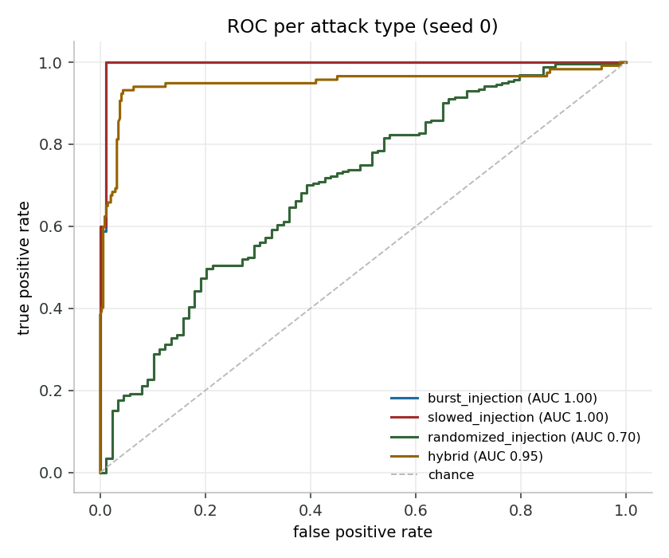
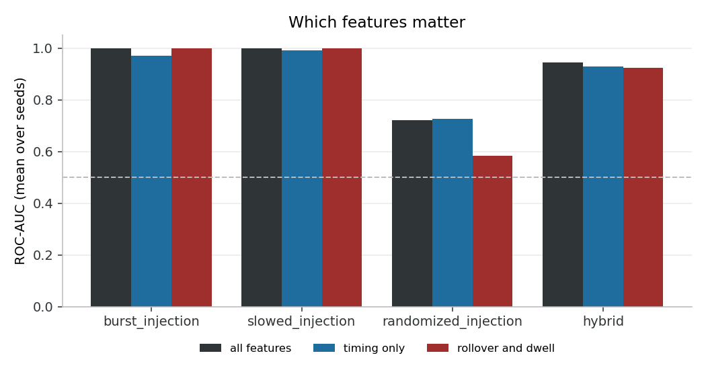
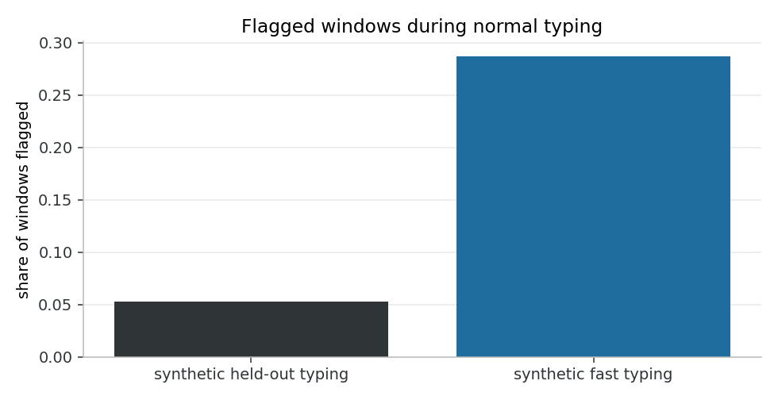
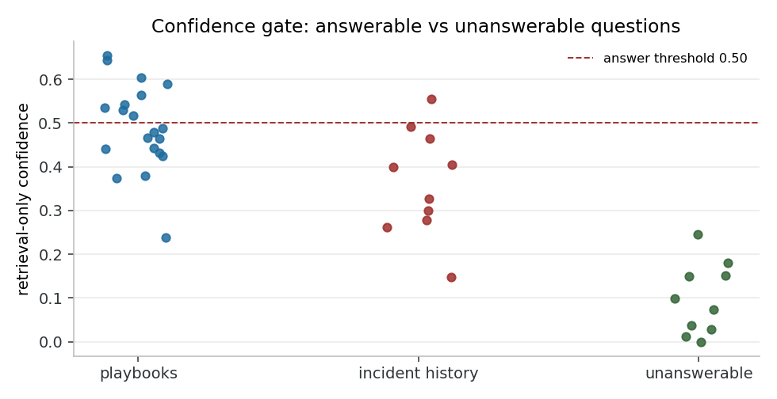
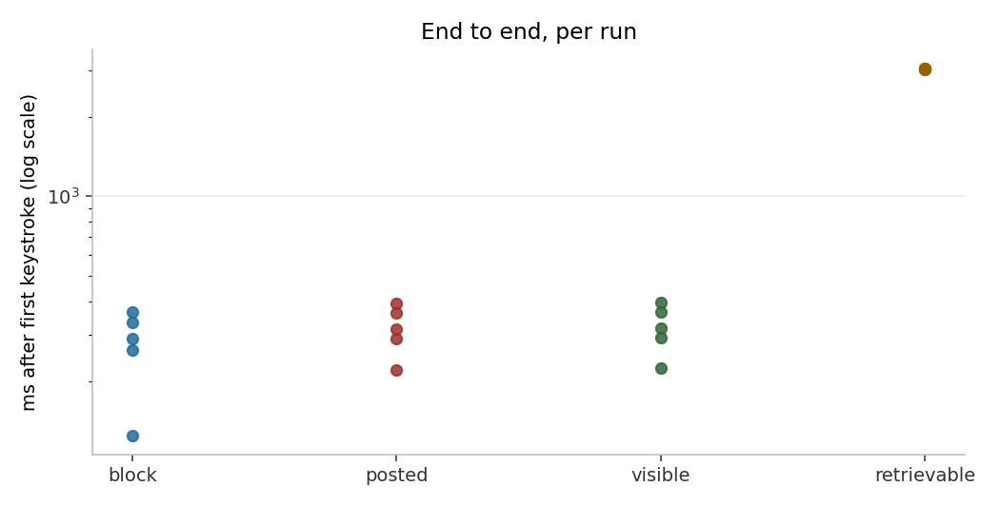

# Continuum evaluation

Generated by `tools/evaluate_all.py` on 2026-10-10 17:41 UTC, from commit f49b2af with uncommitted changes.
Regenerate with `python tools/evaluate_all.py`. Figures are in `docs/figures/`.

## Data used

- **Detector baseline: synthetic.** No recorded baseline with at least 50 windows was found for user `ASUS` in `data/baselines/`, so 446 windows of simulated human typing stand in for it. Every HID Firewall number below therefore measures the detector against the simulator, not against real typing. Record a baseline with `python tools/record_baseline.py ASUS` and rerun to replace them.
- Hardware trials: none recorded yet.
- IncidentRAG answers: not generated (model `llama3.1:8b` unavailable or disabled).
- Simulation seeds: 0, 1, 2, 3, 4.

## 1. HID Firewall

### 1.1 Simulated attack streams

Window-level detection on streams from `tools/simulate_attacks.py`:
20 independently seeded streams per attack type per seed, scored
together with held-out baseline windows (the negative class, never used for training or
calibration). Values are mean ± standard deviation over 5 seeds; each seed
re-splits the baseline, refits and recalibrates the model, and draws fresh attack streams.
A window counts as detected when its score exceeds the calibrated threshold; blocking
additionally needs 2 flagged windows within the debounce
period, so block-level recall can only be lower than the window-level recall shown here.

| attack type | precision | recall | F1 | FPR | ROC-AUC | attack windows per seed |
| --- | --- | --- | --- | --- | --- | --- |
| burst_injection | 0.992 ± 0.008 | 1.000 ± 0.000 | 0.996 ± 0.004 | 0.022 ± 0.025 | 0.999 ± 0.002 | 260 |
| slowed_injection | 0.992 ± 0.008 | 1.000 ± 0.000 | 0.996 ± 0.004 | 0.022 ± 0.025 | 0.999 ± 0.002 | 260 |
| randomized_injection | 0.697 ± 0.357 | 0.038 ± 0.027 | 0.072 ± 0.050 | 0.022 ± 0.025 | 0.722 ± 0.039 | 260 |
| hybrid | 0.712 ± 0.097 | 0.938 ± 0.024 | 0.807 ± 0.068 | 0.141 ± 0.059 | 0.943 ± 0.023 | 117 |

Hybrid streams mix human typing with an injected burst; their windows are labelled by
whichever makes up most of the window, so windows straddling the boundary count as
negatives that look partly like an attack. That is why hybrid's false positive rate and
precision differ from the other rows, which all share the same held-out negatives.

### 1.2 Feature ablation

The same evaluation, refitting and recalibrating the model on three feature
subsets. Timing only is every inter-key interval feature (12 features:
`flight_*`, `burst_score`, `interval_entropy`, `autocorr_lag1`, `regularity_ratio`).
Rollover and dwell is how long keys are held and whether they overlap
(5 features: `dwell_*`, `rollover_ratio`). Each cell is
window-level recall / ROC-AUC, mean ± standard deviation over 5 seeds.

| attack type | all features | timing only | rollover and dwell |
| --- | --- | --- | --- |
| burst_injection | 1.00 ± 0.00 / 1.00 ± 0.00 | 0.36 ± 0.29 / 0.97 ± 0.01 | 1.00 ± 0.00 / 1.00 ± 0.00 |
| slowed_injection | 1.00 ± 0.00 / 1.00 ± 0.00 | 0.90 ± 0.20 / 0.99 ± 0.01 | 1.00 ± 0.00 / 1.00 ± 0.00 |
| randomized_injection | 0.04 ± 0.03 / 0.72 ± 0.04 | 0.00 ± 0.00 / 0.73 ± 0.04 | 0.08 ± 0.04 / 0.58 ± 0.04 |
| hybrid | 0.94 ± 0.02 / 0.94 ± 0.02 | 0.45 ± 0.26 / 0.93 ± 0.02 | 0.95 ± 0.02 / 0.92 ± 0.03 |

### 1.3 False positive study

Typing that is not an attack, replayed through the real scorer (threshold and
2-window debounce), counting blocks as the runtime would,
including resetting the device after each block. A block here is a false block. When no
block happens, the upper bound column gives the rate that still cannot be ruled out at 95
percent confidence for the amount of typing replayed.

| session | windows | flagged windows | false blocks | typing minutes | false blocks per hour | 95% upper bound per hour |
| --- | --- | --- | --- | --- | --- | --- |
| synthetic held-out typing (40 to 120 wpm) | 2032 | 107 | 16 | 84.1 | 11.41 |  |
| synthetic fast typing (120 to 160 wpm) | 2314 | 664 | 263 | 46.3 | 340.93 |  |

- No recorded baseline was available, so both rows replay synthetic typing against a model trained on synthetic typing. This shows how the debounce and threshold behave, not how often a real person would be blocked.

### 1.4 Hardware trials

No hardware trial data yet: `hardware_trial_results.csv` does not exist. To produce it,
flash the sketches in `tools/attacks/` (see its README for the safe procedure), start the
runtime and the connector, and run `python tools/run_hardware_trial.py`, doing five runs per
payload. Each run records whether an incident appeared, key presses and milliseconds from the
first injected keystroke to the block and to the lock, and how many of the 137
payload characters you saw land in the editor. Rerun this script afterwards and this section
fills in.

## 2. IncidentRAG

Evaluated on `data/eval/rag_questions.yaml`: 30 answerable
questions (playbooks and incident history) and 10 unanswerable
ones. The index holds 220 chunks: the playbooks plus
200 incidents from `tools/gen_incidents.py` with seed 1337,
embedded with `all-MiniLM-L6-v2`. Rankings are by document, after
hybrid retrieval (dense plus BM25, fused with reciprocal rank fusion) over the top
10 chunks.

#### Retrieval

| questions | n | hit rate at 3 | hit rate at 5 | MRR |
| --- | --- | --- | --- | --- |
| playbooks | 20 | 0.950 | 1.000 | 0.887 |
| incident history | 10 | 0.700 | 0.800 | 0.669 |
| all answerable | 30 | 0.867 | 0.933 | 0.815 |

#### Confidence gate

The gate abstains when confidence is below 0.5. Without an
LLM answer to check, confidence combines top similarity, the margin to the second result
and how many chunks clear the 0.45 similarity floor. "Without gate"
means always answering from whatever was retrieved.

|  | without gate | with retrieval-only gate |
| --- | --- | --- |
| abstention precision | n/a (never abstains) | 0.33 |
| abstention recall (unanswerable abstained) | 0.00 | 1.00 |
| answerable questions wrongly abstained | 0 | 20 of 30 |
| answers built on context without an expected source | 12 | 0 |

#### Answers and citations

**Not measured:** Ollama is running at http://127.0.0.1:11434 but model `llama3.1:8b` is not installed. Generated answers, citation validity, the
full gate (which adds the answer-support check) and wrong-confident answers all need the
local model. Install it with `ollama pull llama3.1:8b` and rerun. The
retrieval-only gate above is the same gate with its answer-support signal replaced by top
similarity, which is what IncidentRAG uses before an answer exists.

#### Per question

| id | group | first expected rank | top similarity | retrieval confidence | retrieval gate |
| --- | --- | --- | --- | --- | --- |
| pb-01 | playbooks | 2 | 0.58 | 0.47 | abstain |
| pb-02 | playbooks | 2 | 0.63 | 0.53 | answer |
| pb-03 | playbooks | 1 | 0.71 | 0.65 | answer |
| pb-04 | playbooks | 1 | 0.48 | 0.44 | abstain |
| pb-05 | playbooks | 1 | 0.55 | 0.43 | abstain |
| pb-06 | playbooks | 1 | 0.31 | 0.24 | abstain |
| pb-07 | playbooks | 1 | 0.49 | 0.38 | abstain |
| pb-08 | playbooks | 1 | 0.55 | 0.48 | abstain |
| pb-09 | playbooks | 1 | 0.67 | 0.56 | answer |
| pb-10 | playbooks | 1 | 0.70 | 0.59 | answer |
| pb-11 | playbooks | 1 | 0.58 | 0.46 | abstain |
| pb-12 | playbooks | 4 | 0.55 | 0.54 | answer |
| pb-13 | playbooks | 1 | 0.51 | 0.43 | abstain |
| pb-14 | playbooks | 1 | 0.69 | 0.64 | answer |
| pb-15 | playbooks | 2 | 0.50 | 0.44 | abstain |
| pb-16 | playbooks | 1 | 0.47 | 0.37 | abstain |
| pb-17 | playbooks | 1 | 0.52 | 0.49 | abstain |
| pb-18 | playbooks | 1 | 0.62 | 0.60 | answer |
| pb-19 | playbooks | 1 | 0.66 | 0.54 | answer |
| pb-20 | playbooks | 1 | 0.65 | 0.52 | answer |
| inc-01 | incident history | 4 | 0.38 | 0.26 | abstain |
| inc-02 | incident history | 1 | 0.48 | 0.40 | abstain |
| inc-03 | incident history | 1 | 0.53 | 0.46 | abstain |
| inc-04 | incident history | 1 | 0.43 | 0.30 | abstain |
| inc-05 | incident history | >10 | 0.42 | 0.28 | abstain |
| inc-06 | incident history | 3 | 0.53 | 0.49 | abstain |
| inc-07 | incident history | 1 | 0.52 | 0.41 | abstain |
| inc-08 | incident history | 9 | 0.21 | 0.15 | abstain |
| inc-09 | incident history | 1 | 0.58 | 0.56 | answer |
| inc-10 | incident history | 1 | 0.49 | 0.33 | abstain |
| off-01 | unanswerable |  | 0.06 | 0.03 | abstain |
| off-02 | unanswerable |  | 0.05 | 0.04 | abstain |
| off-03 | unanswerable |  | 0.14 | 0.10 | abstain |
| off-04 | unanswerable |  | 0.12 | 0.07 | abstain |
| off-05 | unanswerable |  | -0.00 | 0.00 | abstain |
| off-06 | unanswerable |  | 0.06 | 0.01 | abstain |
| off-07 | unanswerable |  | 0.35 | 0.25 | abstain |
| off-08 | unanswerable |  | 0.22 | 0.15 | abstain |
| off-09 | unanswerable |  | 0.25 | 0.18 | abstain |
| off-10 | unanswerable |  | 0.25 | 0.15 | abstain |

## 3. End to end

5 runs of a simulated 137-keystroke burst injection, replayed in
real time through the runtime's own event handling and posted to a live in-process connector,
whose background watcher ingests new incidents into IncidentRAG's store. 5 of
5 runs were blocked, after 40 key presses on average (every one
of which would already have reached the focused window; see Limitations).

| ms from the first injected keystroke to | mean | median | p95 | max |
| --- | --- | --- | --- | --- |
| blocking window scored | 274 | 289 | 359 | 365 |
| incident accepted by the connector | 316 | 315 | 387 | 393 |
| incident readable through the API the dashboard uses | 319 | 318 | 390 | 396 |
| incident retrievable by IncidentRAG | 3035 | 3034 | 3049 | 3053 |

Not included: the Raw Input delivery delay before the runtime sees a keystroke, the
LockWorkStation and pnputil calls (the evaluation runs in alert-only mode), and the loopback
TCP hop to the connector. The dashboard's Incidents page caches the incident list for up to
10 seconds, so an incident can take that much longer to show there than through the API.
Retrieval latency is dominated by the watcher's 3-second polling interval.

## 4. Limitations

1. **Slowed and randomized injection get past timing features.** Randomized injection, typed at a human-like average speed with human-like spread, is largely missed: window-level recall 0.04 with all features and 0.00 with timing features alone. Slowed injection is caught (timing-only recall 0.90) only because its spacing is perfectly even, which no person produces; a slowed payload with a little added jitter becomes the randomized case. What separates the two in the ablation is mostly dwell and rollover, which an injection tool that also randomises key hold times would remove. Catching a careful attacker reliably needs signals beyond keystroke timing.

2. **Raw Input is observe-only, so keystrokes land before containment.** Raw Input gives Continuum a copy of each keystroke; it cannot hold back, delay or drop one. Every keystroke typed before the workstation locks reaches the focused window. The detector needs a full 30-press window, and blocking needs a second flagged window 10 presses later, so nothing can be blocked before the 40th key press: at burst speed (1 to 10 ms per key) that is 40 to 400 ms of typing that always lands. In the end-to-end replay, 40 keystrokes were typed before the block. A payload shorter than 40 keystrokes, for example opening the Run dialog and typing a short command, is never detected at all.

3. **The baseline is small.** No recorded baseline was available for this run, so the detector was trained and tested on simulated typing only; none of the HID Firewall numbers above say how it behaves for a real person. The model targets a 1% window false positive rate; on held-out windows it measured 0.022. Replayed typing gave synthetic held-out typing (40 to 120 wpm): 11.4 false blocks per hour; synthetic fast typing (120 to 160 wpm): 340.9 false blocks per hour. Typing faster than anything in the baseline is the main source of false blocks; a baseline should include a deliberately fast session.

4. **The Digispark bootloader delays every attack, and the timings here exclude it.** After being plugged in, a Digispark runs its bootloader for about 5 seconds, enumerating as a different USB device, before re-enumerating as a keyboard and running the sketch, which waits a further 3 to 10 seconds. Continuum sees no keystrokes during that time, so it has nothing to detect, and every timing in this document starts at the first keystroke: plug-in to lock is several seconds longer than the figures above. The re-enumerated keyboard counts as a new device, so the stricter new-device threshold applies for its first 60 seconds of typing.

5. **IncidentRAG refuses too often.** The confidence gate, scored on retrieval alone, abstained on 20 of 30 answerable questions while catching every unanswerable one. Refusing is the safe failure, but at this rate an analyst gets "insufficient evidence" for many questions the corpus does answer; the 0.5 threshold and the gate's weights need tuning against this question set. In production the gate also scores how well the answer's sentences match their cited sources, which can raise confidence; that part was not measurable here, so this may overstate the problem.

6. **IncidentRAG's answers were not evaluated in this run.** The local Ollama model was not available, so answer quality, citation validity and the full confidence gate are unmeasured; only retrieval and the retrieval-only gate were.
