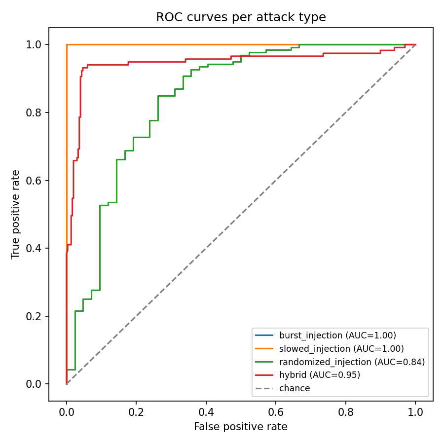

# Continuum detection evaluation results

Model: isolation_forest, version isolation_forest-20261009T183425Z
Target false positive rate: 1.0%
Calibrated decision threshold: 0.0972
Baseline: 208 windows from user 'synthetic_smoke_test' on device synthetic-baseline-keyboard
Held-out normal test windows (real baseline, never used for training or calibration): 42

This model only ever sees keystroke timing. slowed_injection and randomized_injection are both tuned to a human-plausible absolute speed, so a detector that only looked at mean interval would likely miss both; the numbers below show whether that held up in practice. The decision threshold was calibrated against held-out baseline windows only, before any attack stream was generated or scored.

| attack type | precision | recall | F1 | false positive rate | ROC-AUC | attack windows |
| --- | --- | --- | --- | --- | --- | --- |
| burst_injection | 1.000 | 1.000 | 1.000 | 0.000 | 1.000 | 260 |
| slowed_injection | 1.000 | 1.000 | 1.000 | 0.000 | 1.000 | 260 |
| randomized_injection | 1.000 | 0.008 | 0.015 | 0.000 | 0.843 | 260 |
| hybrid | 0.833 | 0.940 | 0.884 | 0.074 | 0.946 | 117 |

Recall is weak on: randomized_injection. A human-plausible mean interval with added jitter does not reliably separate from genuine human typing at this threshold; ROC-AUC above may still be well above 0.5, meaning the raw score does rank these somewhat correctly, just not enough to clear a threshold calibrated for a 1 percent false positive rate. Catching them reliably would need a signal beyond keystroke timing, which is out of scope for this detector.
Despite a human-plausible absolute speed, slowed_injection was still caught reliably here: a perfectly constant interval has zero natural variance, and real human typing never does, so the variance, entropy and regularity features catch it regardless of how slow or fast it is tuned to look.
